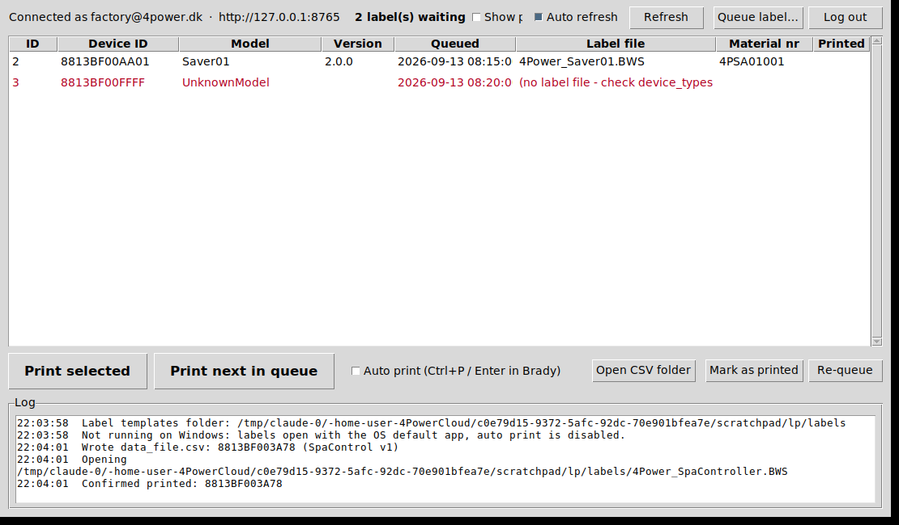

# 4Power Label Printer

Windows desktop tool for the factory: shows the labels waiting in
`printlabels_que`, and prints them one at a time through **Brady Workstation
Custom Designer** on the Brady M611.

## How it works

1. When a device is flashed, a row is inserted into `printlabels_que`
   (`model`, `device_id`, `version`) - unchanged from before.
2. The tool polls the 4Power web API (`listprintlabels`) and lists every
   unprinted row. Each row is joined with `device_types` on `model`, so the
   label template (`labelfile`), packaging file, material number and LED texts
   come straight from the database.
3. **Print selected** / **Print next in queue** (or double-click / Enter):
   - writes **one row** to the CSV data file the label templates link to
     (Brady only accepts one label at a time),
   - opens the model's `.BWS` file with the default application, i.e. Brady
     Workstation, which re-reads the data file,
   - optionally sends `Ctrl+P` and `Enter` to Brady Workstation ("Auto print"),
   - asks "Was the label printed OK?" and on *Yes* marks the row printed
     (`confirmprintlabel`) so it disappears from the queue.
4. **Show printed** + **Re-queue** brings an already printed label back if it
   needs a reprint. **Queue label…** adds a device by hand.

Rows shown in red have no label file: set `device_types.labelfile` for the
model (or add an override in `config.json`).

## Setup on the factory PC (Windows 11)

1. Install Python 3.10 or newer from <https://www.python.org/downloads/windows/>
   (keep "tcl/tk and IDLE" ticked - it is on by default). No other packages are
   needed.
2. Copy this folder (`tools/label-printer`) to the PC, for example
   `C:\4Power\LabelPrinter`.
3. Copy `config.example.json` to `config.json` and edit it (see below).
4. Put the label templates (`*.BWS`) in the `labels_folder`. Every template
   must link to the **same** data file, the one named in `csv_file`
   (Brady Workstation: *Data* → *Data source* → the CSV; tick that the first
   row is the header). The column names are the ones in `csv_columns`.
5. Double-click `run.bat`, log in with a 4Power admin or operator account.
   The login is remembered in `session.json` until you log out.

Use a dedicated factory user (company type *admin*, role *operator*) rather
than a personal account: the API keeps one app token per user, so logging in
here logs that user out of the phone app.

The API functions used by the tool (`listprintlabels`, `confirmprintlabel`,
`requeueprintlabel`, `addprintlabel`) live in `Backend API/modules/printlabels.mjs`
and must be deployed with the web API Lambda.

## config.json

| Key | Meaning |
| --- | --- |
| `api_url` | `https://api.4power.dk/web_api` (or `.../web_api_dev`). |
| `ca_bundle` | Optional PEM file with root certificates, used instead of the Windows store. See *Certificate error* below. |
| `verify_ssl` | Leave `true`. `false` skips certificate checking and is only for finding out whether a proxy is in the way. |
| `csv_file` | The data file the Brady templates link to. Written fresh before every print: header + one row. |
| `labels_folder` | Folder with the `.BWS` templates. `device_types.labelfile` is looked up here unless it is an absolute path. |
| `url_template` | URL printed in the QR code. `{device}` and `{model}` are replaced. |
| `url_templates_by_model` | Per-model override of `url_template`, keyed by `device_types.model`. |
| `labelfile_by_model` | Per-model override of the template file, for models whose `device_types.labelfile` is empty. |
| `csv_columns` | Column order/names in the data file. Available: `Device`, `URL`, `Materialnr`, `Model`, `Version`, `Date`, `Led1`, `Led2`, `Led3`, `Label`, `Emballage`, `Configuration`, `Description`, `Id`. Keep the names your templates were mapped with. |
| `csv_encoding` | `utf-8` (default) or `cp1252` if a template was set up with an ANSI file. |
| `date_format` | Python `strftime` format for `Date`, in the PC's local time. |
| `refresh_seconds` | Queue polling interval while "Auto refresh" is ticked. |
| `confirm_mode` | `ask` (default: Yes/No dialog after the label opens), `auto` (mark printed as soon as the label is opened / auto-printed), `manual` (only the *Mark as printed* button). |
| `close_brady_before_open` + `brady_process_name` | Kill Brady Workstation before opening the next label so the data file is always re-read. Find the process name in Task Manager → Details. Off by default. |
| `auto_print.enabled` | Default state of the *Auto print* checkbox. |
| `auto_print.window_title` | Text that must appear in the Brady window title. |
| `auto_print.window_wait_seconds` | How long to wait for that window after opening the template. |
| `auto_print.print_dialog_wait_seconds` | Pause between `Ctrl+P` and `Enter`, so the print dialog is fully open. |
| `auto_print.close_document_after_print` | Send `Ctrl+W` after printing. |
| `auto_print.confirm_after_auto_print` | With `confirm_mode: ask`, skip the Yes/No dialog when the keystrokes were sent. |

## Certificate error at login

`CERTIFICATE_VERIFY_FAILED ... unable to get local issuer certificate` means
Python could not find the root certificate that api.4power.dk chains to.
Python on Windows only trusts roots that Windows has already downloaded, and a
fresh PC has often not fetched the Amazon root yet. Any one of these fixes it:

1. Open <https://api.4power.dk> in Edge once. Windows downloads the root, and
   the tool works from then on.
2. `py -3 -m pip install truststore` (the tool asks Windows through it, which
   also triggers the download), or `py -3 -m pip install certifi` (a bundled
   root list). Restart the tool after installing.
3. Point `ca_bundle` in `config.json` to a PEM file with the roots.

If it still fails after that, something on the network replaces the
certificate (a proxy or security product). `verify_ssl: false` confirms that
by making the login work; then fix the proxy rather than leaving it off.

## Auto print

Brady Workstation has no command-line or API in the edition in use, so "auto
print" simply types the shortcuts an operator would: bring the Brady window to
the front, `Ctrl+P`, wait, `Enter`. Test it once with the checkbox ticked and
Brady already open:

- If the print dialog is still opening when `Enter` arrives, raise
  `print_dialog_wait_seconds`.
- If the label opens but nothing happens, check `window_title` against the
  real title bar text and raise `window_wait_seconds`.
- If Brady keeps the previous document open and does not re-read the data
  file, enable `close_brady_before_open` with the right `brady_process_name`,
  or tick `close_document_after_print`.

While a print is in progress the queue is not refreshed and a second print is
refused until the current one is confirmed or declined.
